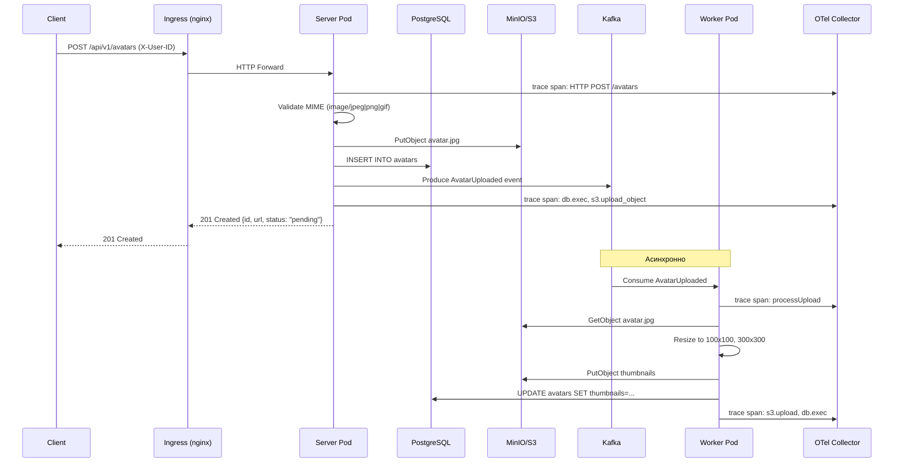
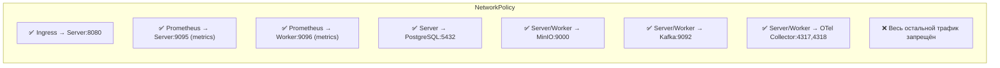

# Архитектура GophProfile

GophProfile — production-ready Go-микросервис для управления аватарками пользователей.
Сервис спроектирован для запуска в Kubernetes с full-stack observability (logs, metrics, traces).

## Высокоуровневая архитектура

```mermaid
graph TB
    Client[Клиент / Мобильное приложение]
    
    subgraph K8s["Kubernetes Cluster"]
        subgraph Ingress["Namespace: gophprofile"]
            IG[Ingress<br/>nginx-ingress]
        end
        
        subgraph App["Namespace: gophprofile"]
            SVC[Service: gophprofile-server<br/>ClusterIP:8080]
            SVC_M[Service: gophprofile-server-metrics<br/>ClusterIP:9095]
            SVC_W[Service: gophprofile-worker-metrics<br/>ClusterIP:9096]
            
            DEP_S[Deployment: gophprofile-server<br/>replicas: 2-10 (HPA)]
            DEP_W[Deployment: gophprofile-worker<br/>replicas: 1-3 (HPA)]
            
            HPA[HorizontalPodAutoscaler]
            PDB[PodDisruptionBudget]
            NP[NetworkPolicy]
            SM[ServiceMonitor]
            SA[ServiceAccount]
            CM[ConfigMap]
            SC[Secret]
        end
        
        subgraph DB["Namespace: database"]
            PG[(PostgreSQL<br/>StatefulSet)]
        end
        
        subgraph MSG["Namespace: messaging"]
            KAF[(Kafka<br/>StatefulSet)]
        end
        
        subgraph OBS["Namespace: monitoring"]
            PROM[Prometheus]
            GRAF[Grafana]
            JAEG[Jaeger]
            OTEL[OTel Collector]
            LOKI[Loki]
        end
    end
    
    Client -->|HTTPS| IG
    IG -->|HTTP:8080| SVC
    SVC --> DEP_S
    DEP_S -->|5432| PG
    DEP_S -->|9000| MinIO
    DEP_S -->|9092| KAF
    DEP_S -->|4317,4318| OTEL
    
    DEP_S -->|scrape:9095| PROM
    DEP_W -->|scrape:9096| PROM
    PROM --> SM
    PROM --> GRAF
    PROM --> JAEG
    OTEL -->|push traces| JAEG
    OTEL -->|push logs| LOKI
    OTEL -->|push metrics| PROM
```

## Поток обработки запроса



## Сетевая модель



## Компоненты observability

| Сигнал | Источник | Pipeline | Хранилище | UI |
|--------|----------|----------|-----------|-----|
| **Metrics** | `avatars_*` (бизнес) + otelhttp (HTTP) | app → OTel Collector → Prometheus | Prometheus TSDB | Grafana |
| **Traces** | otelhttp + pgx + s3 spans | app → OTel (gRPC:4317) → Jaeger | Jaeger storage | Jaeger UI |
| **Logs** | zerolog (stdout) + otelslog (OTLP) | app → OTel (gRPC:4317) → Loki | Loki chunks | Grafana Explore |

## Технологический стек

| Слой | Технология | Версия |
|------|------------|---------|
| Язык | Go | 1.25 |
| HTTP-роутер | chi/v5 | v5 |
| БД | PostgreSQL | 16 |
| Брокер | Apache Kafka | 7.6 |
| S3 | MinIO | latest |
| Метрики | Prometheus | v3 |
| Трейсы | Jaeger | 1.62 |
| Логи | Loki | 3.6 |
| OTel | OpenTelemetry Collector | 0.143 |
| Контейнеры | Docker | multi-stage alpine |
| K8s | Kubernetes | 1.30+ |
| Пакетный менеджер | Helm | 3.x |

## Слои Helm chart

```
deploy/helm/gophprofile/
├── Chart.yaml              # Метаданные чарта
├── values.yaml             # Дефолтные значения
├── values-dev.yaml         # Для dev-окружения
├── values-prod.yaml        # Для production
├── .helmignore
└── templates/
    ├── _helpers.tpl        # Шаблонные функции
    ├── serviceaccount.yaml # SA с минимальными правами
    ├── configmap.yaml      # Несекретная конфигурация
    ├── secret.yaml         # Чувствительные данные
    ├── deployment.yaml     # Server Deployment + Probes
    ├── worker-deployment.yaml
    ├── service.yaml        # ClusterIP для app + metrics
    ├── ingress.yaml        # nginx-ingress
    ├── hpa.yaml            # HPA для server/worker
    ├── poddisruptionbudget.yaml
    ├── networkpolicy.yaml  # Ограничение трафика
    ├── servicemonitor.yaml # Prometheus Operator
    ├── migration-job.yaml  # Helm hook для миграций БД
    └── NOTES.txt           # Инструкции после helm install
```

## Безопасность

- **non-root контейнеры** (UID 65534)
- **readOnlyRootFilesystem** (с /tmp на emptyDir)
- **drop ALL Linux capabilities**
- **runAsNonRoot: true**
- **seccompProfile: RuntimeDefault**
- **NetworkPolicy** — минимальный набор разрешённых соединений
- **Secret через K8s Secrets** (рекомендуется external-secrets или Vault)
- **Без привилегированных маунтов, без hostNetwork**
- **Образы из GHCR** (или private registry) с pullSecrets
- **Graceful shutdown** — preStop hook + 30 сек terminationGracePeriod

## Production-ready checklist

- [x] Multi-stage Dockerfile с non-root
- [x] Resource requests/limits
- [x] Liveness + Readiness + Startup probes
- [x] HPA по CPU и Memory
- [x] PodDisruptionBudget
- [x] NetworkPolicy
- [x] ServiceMonitor для Prometheus
- [x] ConfigMap + Secret раздельно
- [x] ServiceAccount с минимальными правами
- [x] Ingress с TLS
- [x] Graceful shutdown (preStop + terminationGracePeriod)
- [x] Helm chart с values для dev/staging/prod
- [x] Helm hook для миграций БД
- [x] NOTES.txt с инструкциями
- [x] OpenAPI 3.0 спецификация
- [x] README с инструкциями по запуску
